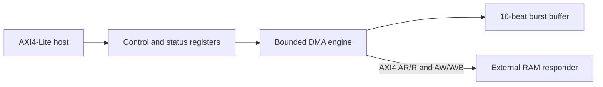

# AXI4 DMA Subsystem

## Separate deterministic UVM/SVA review milestone

The [adapter and run guide](docs/DETERMINISTIC_UVM_ADAPTER.md) links the corrected
AMBA-hosted UVM environment and fresh detached evidence: **47/47 required PASS**,
68 scenarios, 30 SVA controls and ten qualified nonzero fault children. Enabled
WDATA lanes and rejected-CSR side effects have targeted old/new qualification.
Three new measured crops have verified original-capture hashes. The original
43-substep report, 40-case portable result and 11-file provenance are preserved;
no DUT or portable-test input changed. Coverage, constrained randomization and
original advanced ALU/APB environments remain NOT RUN. Both PRs are open and
unmerged; this separate review milestone preserves the portable release below.

A bounded single-channel, memory-to-memory DMA with a 32-bit AXI4-Lite
control interface and a 64-bit AXI4 data path. It copies 0–4096 bytes
between eight-byte-aligned RAM addresses, splits 1–16-beat INCR bursts at
both source and destination 4 KiB boundaries, and uses byte strobes for the
final partial beat. Transfers are sequential: one read burst is buffered,
then its matching write burst completes before the next pair. AW and W
progress independently; either address or data can be accepted first.

The latest technical-completion branch qualified **40 named cases and
1,352,655 checks** at tested source `a2148a1e817b0981714962264e3af4a7fb838ea6`.
It includes 1-, 2- and 16-beat all-W-before-AW and same-cycle AW/W ordering,
all final-byte tails 1–7, and coincident 4 KiB splits. Two disposable
AW/W-progress tracker faults returned nonzero. Raw logs, JSON and four
[measured waveform figures](reports/technical-completion-2026-11-07/)
are separate from the earlier published 27-case milestone. This branch has
not yet passed a new published locked aggregate.



The implementation and its contract are in
[SPECIFICATION.md](docs/SPECIFICATION.md). The
[verification plan](docs/VERIFICATION.md) maps each bounded requirement to
independent byte-memory and accepted-handshake checks. Actual results and
their revision are in [RESULTS.md](docs/RESULTS.md).

## Run

Install ModelSim/Questa tools providing `vlib`, `vlog`, and `vsim`;
the recorded local configuration uses ModelSim Intel FPGA Starter Edition
2020.1. From a clean checkout, choose a **new** output directory:

```powershell
$env:PATH = "C:\intelFPGA\20.1\modelsim_ase\win32aloem;$env:PATH"
powershell.exe -NoProfile -ExecutionPolicy Bypass -File scripts/run_regression.ps1 -OutputDir run-output-1
python scripts/check_provenance.py
```

The simulation wrapper returns nonzero on compile errors, simulator errors,
missing completion, check failures, or timeout. The bench uses a fixed seed
and has its own watchdog. See [RESULTS.md](docs/RESULTS.md) for observed
counts and limits.

Use `-Case all_w_before_aw_16 -CaptureWave` with a fresh output directory
for a targeted VCD/SVG. The default run enforces the exact 40-case inventory.

## Provenance and limits

M. Roohan Khan and Talib jointly developed the
[`DMA-PROTOCOL`](https://github.com/sha1kh-talib/DMA-PROTOCOL)
reference; Roohan confirms Talib permits reuse and enhancement. This
repository retains its pinned commit
`85868386f1d4c105b8baa666c5a6c273756fa8e5` as an ancestor, all
original Verilog files under `upstream/code-files/`, and its MIT licence
and `DMA RTL Team` copyright notice in
[UPSTREAM_README.md](docs/UPSTREAM_README.md). The 11-file
[provenance map](SOURCE_PROVENANCE.json) verifies the archived blobs.
The related [AMBA AXI Full DMA integration](https://github.com/sha1kh-talib/AMBA-AXI-Full-DMA-Integration)
was inspected as context, without mixing its source into this milestone.
See [PROVENANCE.md](docs/PROVENANCE.md).

The active bounded engine replaces the archived multichannel data path
because its FIFO data nets had competing owners and its burst calculation
did not visibly cap at 4 KiB. The archived multichannel, descriptor,
peripheral-handshake and deeper-outstanding features are **not** claimed
as verified. The testbench does not establish full AXI4 compliance,
coverage closure, synthesis, timing closure or FPGA operation.

Protocol reference: [Arm AMBA AXI and ACE Protocol Specification,
ARM IHI 0022H](https://developer.arm.com/-/media/Arm%20Developer%20Community/PDF/IHI0022H_amba_axi_protocol_spec.pdf).
